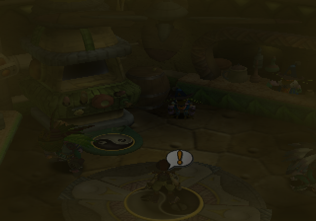
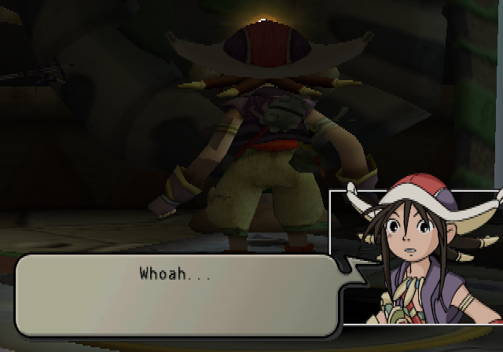
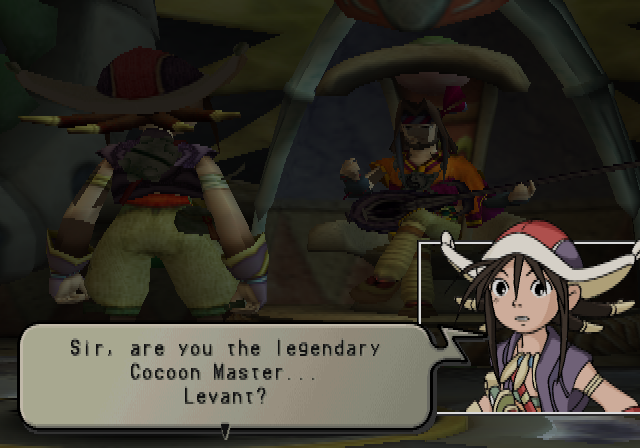
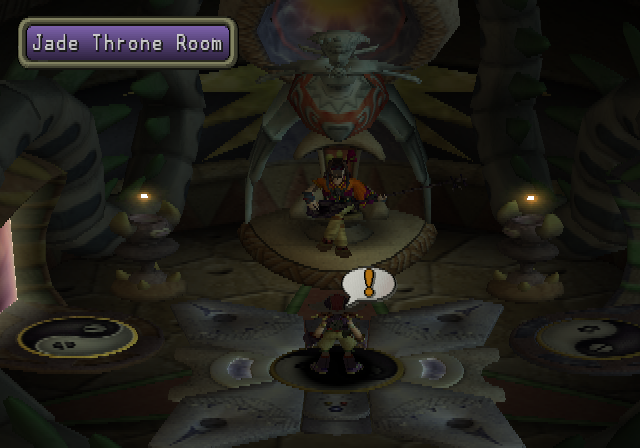

<div align="center">

# JC2_Recomp

**A native Windows and Linux port of *Jade Cocoon 2* (NTSC-U, `SLUS-20309`), made by statically recompiling the game's PlayStation 2 code to C++.**<br>
Not an emulator: the game's own MIPS R5900 code, rebuilt as a native program on a reimplementation of the PS2 hardware.


</div>

> [!IMPORTANT]
> No game files are included: no ELF, IRX modules, data archives, or code generated from them.
> You need **your own copy** of the North American release, PS2 ID **`SLUS-20309`**. The port is built against that disc's executable:
>
> | File | SHA-1 |
> |---|---|
> | `SLUS_203.09` | `fa778a8dcb5a16e8146976fe4ab444856f04c47b` |

## Status

**Bring-up, not playable yet.** On the full native path (no paraLLEl-GS, no IOP interpreter) the game boots through
the intro movies, the title screen and the main menu, and New game plays the opening movie and the first in-game scenes
with their dialogue, up to free control in the Jade Throne Room. Windows comes first, then Linux.

| Milestone | |
|---|:---:|
| Map the stripped main ELF (Ghidra function map, data spans filtered out, SDK functions from the fork's signature database) | ✅ |
| Recompile it and link the generated code with the PS2Recomp runtime (Windows) | ✅ |
| Boot: EE kernel, CD reads from the disc files, the game's 13 IOP modules recompiled to native code | ✅ |
| Code overlays: the 1368 CodeWarrior modules loaded at run time recompiled, static initializers included | ✅ |
| Movies, title screen, main menu | ✅ |
| Native GS renderer (OpenGL, no GS emulation) | ✅ |
| Sound and music (SPU2 and IOP on the PC clock) | 🔧 |
| New game: opening movie, first in-game scene and dialogue | ✅ |
| 60 fps on the vblank grid (PC clock); native frame loop | 🔧 |
| VU1 microcode compiled ahead of time (`ps2_vu_aot`): no VU interpreter in play | ✅ |
| Field exploration (free control in the Jade Throne Room after the opening) | ✅ |
| First battle | ⏳ |
| Memory card saves | ⏳ |
| Linux build | ⏳ |
| Widescreen, higher internal resolution | ⏳ |

✅ works · 🔧 in progress · ⏳ not reached yet

[docs/RECOMP_NOTES.md](docs/RECOMP_NOTES.md) records how the port is brought up, every fix and how it was found, and
what remains open.

## Screenshots

The first in-game scenes on the full native path (native GS renderer, native IOP modules, recompiled overlays), up to free control in the Jade Throne Room:

| | | |
|---|---|---|
|  |  |  |
|  | | |


## Goal

A fully playable *Jade Cocoon 2* as a native executable on Windows and Linux, from the intro to the end of the story.
Accuracy first; once it is playable, widescreen and higher internal resolution.

## How it works

```
disc files (game/) ──► Ghidra (headless, EE extension) + ExportPS2Functions ──► tools/filter_ghidra_map.py
                   ──► recomp/ghidra/jc2_functions.csv ──► ps2_analyzer (SCE SDK signatures) ──► recomp/jc2_slus20309.toml
                                           │
                     ps2_recomp ──► C++ (one file per function, generated/) · ps2_vu_aot ──► VU1 microcode (generated/vu1/)
   CDDATA.000 overlays ──► tools/find_overlays.py ──► ps2_recomp in module mode ──► generated/overlays/ (1368 modules)
   the game's IRX (dumped by a first run) ──► the fork's tools/iop_recomp.py ──► generated/iop/ (13 modules)
                                           │
                 CMakeLists.txt ──► PS2Recomp runtime + generated code + runtime/jc2_overrides.cpp
                                           │
   PS2Recomp runtime: EE kernel HLE · DMAC · GIF · native GS renderer (OpenGL) · VIF/VU0/VU1 · IPU ─┼─► ps2EntryRunner
   PS2Recomp IOP:     the game's own IRX as native code · SPU2 and IOP on the PC clock · SIO2
```

- The retail executable is stripped, and its code and data share a single segment. Ghidra with the Emotion Engine
  extension maps the functions; `tools/filter_ghidra_map.py` drops the entries Ghidra put on data, and `ps2_analyzer`
  names the Sony SDK functions that have runtime handlers from the fork's signature database (244 at first pass).
- PS2Recomp turns every function into C++ (72,000 functions) and emits the address-indexed function table.
- The top-level `CMakeLists.txt` builds the fork's runtime, swaps its placeholder function table for the generated one
  and links everything into `ps2EntryRunner`.
- `runtime/jc2_overrides.cpp` holds the game-specific bindings.

The PS2Recomp fork lives in `PS2Recomp/` (git submodule, [boubou666/PS2Recomp](https://github.com/boubou666/PS2Recomp)),
shared with the *Twisted Metal: Black*, *The Third Age*, *Valkyrie Profile 2* and *Drakengard* recompilations.

## Requirements

- Windows 10/11 with [MSYS2](https://www.msys2.org/) (UCRT64, see below) or Linux
- CMake 3.21+, Ninja, GCC 13+ or Clang with C++20
- FFmpeg development libraries (`libavcodec`, `libavformat`, `libavutil`, `libswresample`, `libswscale`) and `pkg-config`
- `bsdtar` (libarchive) to extract the disc, Python 3
- To regenerate the function map: [Ghidra](https://ghidra-sre.org/) 12 with the
  [Emotion Engine extension](https://github.com/chaoticgd/ghidra-emotionengine-reloaded) and a JDK 21
- A CPU with AVX2 (the runtime is built for `x86-64-v3`)
- Your own copy of `SLUS-20309` (check the hash above)

## Build and run

```bash
git clone --recurse-submodules https://github.com/boubou666/JC2_Recomp.git
cd JC2_Recomp
scripts/extract_iso.sh "/path/to/Jade Cocoon 2 (USA).iso"   # disc files -> game/
scripts/build_tools.sh                                       # ps2_recomp, ps2_analyzer, ps2_vu_aot -> build/tools
GHIDRA_INSTALL_DIR=/path/to/ghidra scripts/ghidra.sh         # only to regenerate recomp/ghidra/jc2_functions.csv
scripts/recomp.sh                                            # ELF + recomp/jc2_slus20309.toml -> generated/
scripts/overlays.sh                                          # code overlays in CDDATA.000 -> generated/overlays/
scripts/build_runtime.sh                                     # runtime + generated code -> build/game
PS2X_IOP_NATIVE=0 PS2X_IOP_DUMP_MODULES=build/iop_modules scripts/run.sh   # once: saves the game's IOP modules
scripts/iop_recomp.sh && scripts/build_runtime.sh            # IOP modules -> generated/iop/, rebuild
scripts/run.sh                                               # ps2EntryRunner game/SLUS_203.09
```

### Windows

The same scripts run in an MSYS2 **UCRT64** shell, with MSYS2's GCC (MSVC is not supported for this port).

```bash
pacman -S --needed mingw-w64-ucrt-x86_64-{gcc,cmake,ninja,pkgconf,ffmpeg,libarchive,python} git
```

`scripts/stage_dlls.sh` copies the DLLs the runner needs next to `ps2EntryRunner.exe`, so it can also be started
outside the MSYS2 shell. A full runner build takes about 16 minutes on 16 threads.

`scripts/analyze.sh` regenerates the TOML from scratch; it discards manual edits, so diff before committing.

## Disc facts

| | |
|---|---|
| Boot ELF | `SLUS_203.09`, entry `0x100008`, one segment at `0x100000` (6 MB of code and data), stripped |
| Code | `0x100000-0x4E3E80` and `0x6B2B00-0x6B9310` (static constructors, table at `0x6B9310`) |
| Overlays | ~1,390 zero-size LOAD segments at `0x940000`, filled at run time |
| Video mode | NTSC |
| IOP modules | `IRX/*.IRX`: ATAD, DEV9, HDD, PFS, IMODEDRV, IMODEMAN, M2IMODE, M2IOPSYS, M2SOUND, MODHSYN, MODMIDI, LIBSD, MCMAN, MCSERV, MTAPMAN, PADMAN, SIO2MAN, UAMAN |
| IOP image | `IRX/IOPRP23.IMG` |
| Data | `CDDATA.000` (1.3 GB archive) with its index `CDDATA.LOC`, `MOV/`, `VOICE/` |

## Sharing the machine with other ports

Several PS2Recomp ports are developed on the same machine. A timed game run or benchmark takes the shared bench lock
(the fork's `PS2Recomp/tools/bench_lock.sh`, file `D:/ps2recomp_bench.lock`) first, so that another port's build or
game does not skew it:

```bash
scripts/bench_run.sh 5 "boot timing" scripts/run.sh   # waits for the lock, takes it, runs, releases it on any exit
```

Heavy builds take no lock, but do not start while someone holds it.

## Repository layout

| Path | Contents |
|---|---|
| `recomp/` | Recompiler config (analyzer output plus manual additions) and the Ghidra function map |
| `runtime/` | Game override module (game-specific bindings) |
| `scripts/` | Extract, build tools, Ghidra, analyze, recomp, build runner, run, bench lock |
| `tools/` | `filter_ghidra_map.py` (drops map entries in data), `sync_tree.py` (fast sync of generated code), `find_code_pointers.py` (entry points reached only through pointers) |
| `docs/` | Bring-up notes |
| `PS2Recomp/` | PS2Recomp fork (submodule) |

Everything derived from the game (`game/`, `generated/`, `build/`, disc images, captures) is git-ignored. Never commit or
redistribute it.

## Credits

- [PS2Recomp](https://github.com/ran-j/PS2Recomp) by ran-j and contributors (GPL), the recompiler and runtime this port is built on.
- The *Twisted Metal: Black*, *The Third Age*, *Valkyrie Profile 2: Silmeria* and *Drakengard* recompilations, developed on the same PS2Recomp fork; runtime fixes are shared.
- *Jade Cocoon 2* © Genki, published by Ubisoft in North America. This is an unofficial fan project, not affiliated with or endorsed by them.
